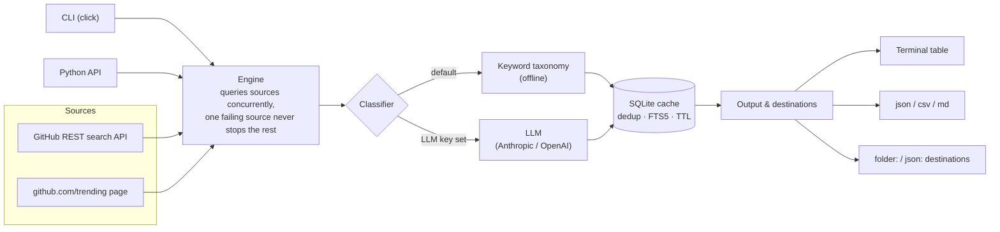

# AIToolsFetcher

[](https://github.com/Ismaimrh/aitoolsfetcher/actions/workflows/ci.yml)

[](LICENSE)

AIToolsFetcher is a Python package and command-line tool for keeping up with new AI tools. It
searches GitHub for AI-related repositories, scores each one for AI relevance and sorts it into a
category (agent, framework, model, infra…), and keeps everything in a local SQLite cache. That way
it can tell you what is new since the last run, and export the results to JSON, CSV or Markdown.
It runs with zero configuration and no API keys. It can also run on an interval or a cron schedule
and drop only the new finds into a folder or a JSON file.

## Works today

- **GitHub source**: repository search through the official REST API, and this week's trending
  repositories from the public github.com/trending page. Rate limits are respected: the client
  waits as GitHub's `retry-after` / `x-ratelimit-reset` headers ask, and stops with a clear
  message instead of hammering the API.
- **Keyword classifier** (default, offline, free): weighted keyword taxonomy over name,
  description and topics.
- **LLM classifier** (optional): used only when you configure an Anthropic or OpenAI API key.
  Those providers bill per call.
- **SQLite cache**: de-duplication across runs (and by source-code URL), full-text search (FTS5),
  and automatic removal of entries older than `cache_ttl_days`.
- **Output**: terminal table or detail panels, plus `json`, `csv` and `md` to stdout or a file.
- **Destinations**: `folder:PATH` (one timestamped file per run) and `json:FILE` (append without
  duplicates).
- **CLI commands**: `search`, `trending`, `history`, `export`, `periodic`, `schedule`, `sources`.

## Roadmap

Planned, not built yet:

- HuggingFace source (official Hub API: trending models and Spaces)
- arXiv source (official API: recent cs.AI / cs.CL / cs.LG papers that link to code)
- Free LLM providers through an OpenAI-compatible `base_url` (Groq free tier, local Ollama), with
  model names moved into config
- Source-code traceback and cross-platform merging for tools found outside GitHub
- Notion and email (SMTP) destinations
- Release on PyPI

Only if the platform's current API terms allow it: Product Hunt (official API only) and Reddit.

Not planned: X/Twitter and LinkedIn. Their terms forbid scraping, and this project does not
collect data from them.

## Install

The package is not on PyPI yet. Install from source:

```bash
pip install git+https://github.com/Ismaimrh/aitoolsfetcher
```

or, for development:

```bash
git clone https://github.com/Ismaimrh/aitoolsfetcher
cd aitoolsfetcher
python -m venv .venv && source .venv/bin/activate
pip install -e ".[dev]"
```

Optional LLM classification: `pip install -e ".[llm]"` (installs the Anthropic and OpenAI SDKs).

## Usage

```bash
aitoolsfetcher search "AI agents"                     # table in the terminal
aitoolsfetcher search "vector database" --limit 10 --min-stars 500
aitoolsfetcher search "AI agents" --format md > agents.md
aitoolsfetcher trending                               # this week's trending AI repos
aitoolsfetcher history                                # what is already in the cache
aitoolsfetcher export --format csv -o tools.csv       # export the cache

# Keep watching: run now, then every 6 hours; only new tools are saved
aitoolsfetcher periodic "LLM evaluation" --every 6h --dest folder:~/ai-tools/

# Or on a cron schedule (local time), e.g. Mondays at 09:00
aitoolsfetcher schedule "AI agents" --cron "0 9 * * MON" --dest json:~/ai-tools.json
```

### Example output

Real output of `aitoolsfetcher search "AI agents" --limit 5`, run on 2026-10-17 at 13:20 UTC with
no config file and no token, in a 120-column terminal:

```text
                                                        AI Tools
┏━━━━━━━━━━━━━┳━━━━━━━━━━━━━┳━━━━━━━━━━━━━━━━━━━━━━━━━━━━━━━━━━━━━━┳━━━━━━━━━━━━━┳━━━━━━━━━━━━━━━━━━━━━━━━━━━━━━━━━━━━━┓
┃ Name        ┃ Category    ┃ What it does                         ┃       Stars ┃ Source                              ┃
┡━━━━━━━━━━━━━╇━━━━━━━━━━━━━╇━━━━━━━━━━━━━━━━━━━━━━━━━━━━━━━━━━━━━━╇━━━━━━━━━━━━━╇━━━━━━━━━━━━━━━━━━━━━━━━━━━━━━━━━━━━━┩
│ AutoGPT     │ model       │ AutoGPT is the vision of accessible  │     187,619 │ https://github.com/Significant-Grav │
│             │             │ AI for everyone, to use and to build │             │ itas/AutoGPT                        │
│             │             │ on. Our mission is to provi...       │             │                                     │
│ hermes-agen │ model       │ The agent that grows with you        │     254,569 │ https://github.com/NousResearch/her │
│ t           │             │                                      │             │ mes-agent                           │
│ firecrawl   │ agent       │ Supercharge your AI agents with data │     192,371 │ https://github.com/firecrawl/firecr │
│             │             │ from the web and beyond. Building    │             │ awl                                 │
│             │             │ the library for superintellig...     │             │                                     │
│ ponytail    │ agent       │ Makes your AI agent think like the   │     165,573 │ https://github.com/DietrichGebert/p │
│             │             │ laziest senior dev in the room. The  │             │ onytail                             │
│             │             │ best code is the code you nev...     │             │                                     │
│ superpowers │ agent       │ An agentic skills framework &        │     300,991 │ https://github.com/obra/superpowers │
│             │             │ software development methodology     │             │                                     │
│             │             │ that works.                          │             │                                     │
└─────────────┴─────────────┴──────────────────────────────────────┴─────────────┴─────────────────────────────────────┘

5 new AI tools found (5 fetched, 0 cached)
```

The categories come from the keyword classifier and are heuristic; for example, two agent
projects above are labelled `model`. A measured precision/recall evaluation is planned.

### Python API

```python
import asyncio

from aitoolsfetcher import AIToolsFetcher


async def main() -> None:
    async with AIToolsFetcher() as fetcher:
        result = await fetcher.search("vector database", limit=5)
        for tool in result.tools:
            print(tool.name, tool.category.value, tool.source_code_or_source)
        print(result.summary)


asyncio.run(main())
```

## Architecture



Sources, classifiers and destinations are independent adapters behind small abstract base
classes (`sources/base.py`, `classifiers/base.py`, `destinations/base.py`), so new ones plug in
without touching the engine.

## Configuration

Nothing is required. To change defaults, copy [`config.example.toml`](config.example.toml) to
`~/.aitoolsfetcher/config.toml`. Environment variables take precedence over the file:

| Variable | Purpose |
|---|---|
| `GITHUB_TOKEN` or `AITF_GITHUB_TOKEN` | Optional GitHub token (no scopes needed) for a higher rate limit |
| `AITF_LLM_KEY` | Optional key; switches classification to the LLM classifier |
| `AITF_LLM_PROVIDER` | `anthropic` (default) or `openai` |

The cache lives at `~/.aitoolsfetcher/cache.db`. Keep keys in the environment or in your
config file, never in the repository.

## Data and privacy

AIToolsFetcher only reads public repository metadata: name, description, topics, stars, language,
licence, and the owner's account or organisation handle as shown on GitHub. It stores this
locally in your cache and nowhere else. It does not collect data from X/Twitter or LinkedIn.

## Development

```bash
pip install -e ".[dev]"
ruff check src tests && ruff format --check src tests
mypy --strict
pytest --cov
```

All network calls in the tests are mocked (`respx` and fake sources), and the tests never read
your real config or cache. CI runs the same checks on Python 3.10, 3.11, 3.12 and 3.13.

Test status, measured on 2026-10-17 with `pytest --cov` (statement + branch coverage of
`src/aitoolsfetcher`) on Python 3.13.5: **161 tests passing, 97% coverage**. The same suite
passes on Python 3.10.17.

## License

[MIT](LICENSE) © 2026 Ismail Rhazi
